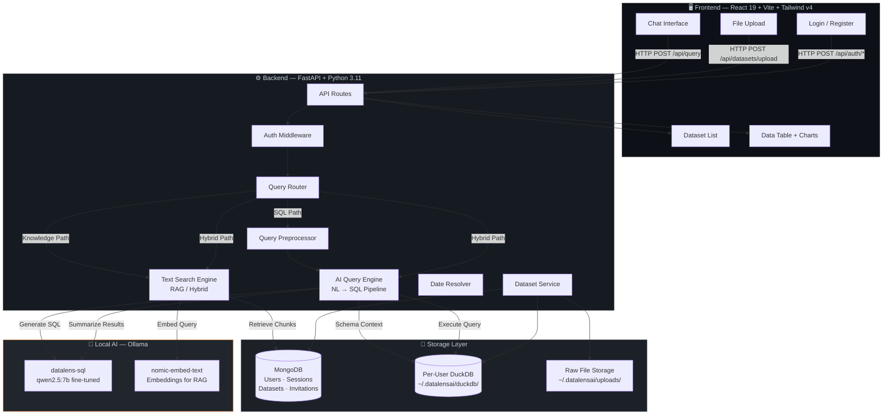
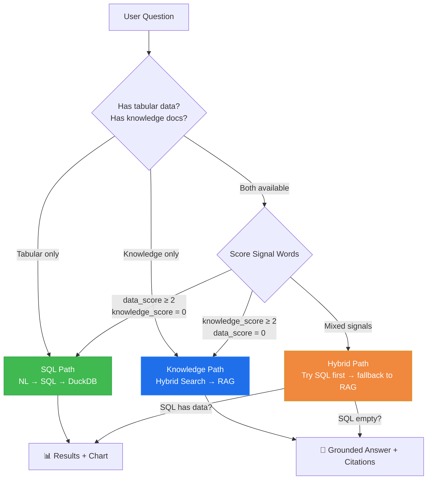
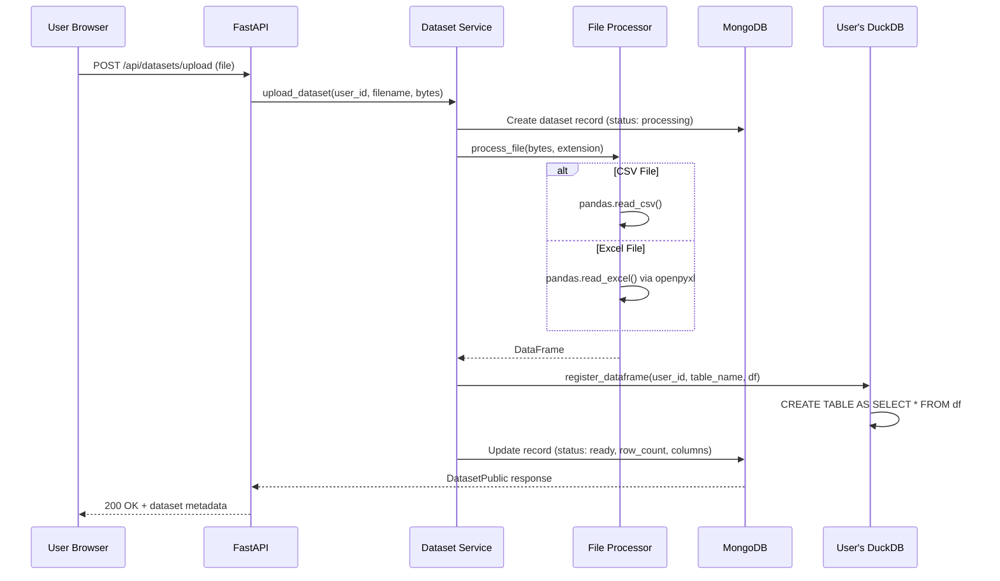
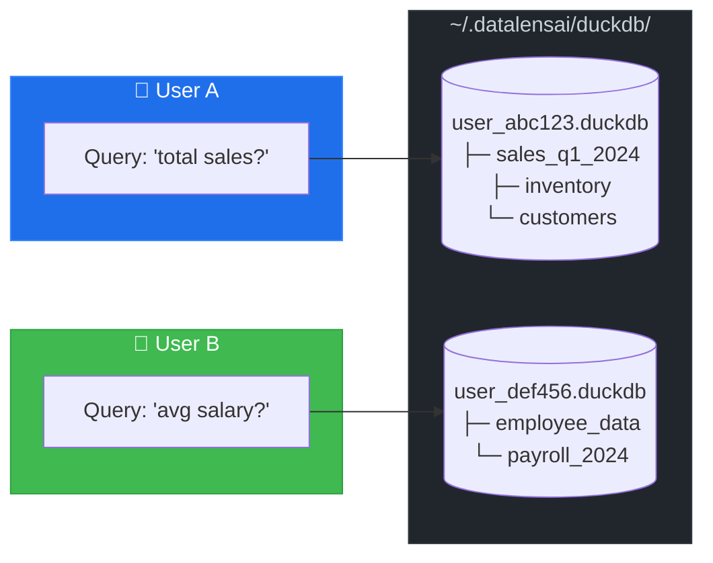

<p align="center">
  
</p>

<h1 align="center">DataLensAI</h1>

<p align="center">
  <strong>Talk to your data. Get answers instantly.</strong><br/>
  A fully local, privacy-first AI data analyst that converts natural language into SQL — powered by your own hardware.
</p>

<p align="center">
  
  
  
  
  
  
  
  
</p>

<p align="center">
  <em>No API keys. No cloud bills. No data leaves your machine.</em>
</p>

---

## Table of Contents

- [Why DataLensAI?](#why-datalensai)
- [Features](#-features)
- [System Architecture](#-system-architecture)
- [NL → SQL Query Pipeline](#-nl--sql-query-pipeline)
- [Query Routing Engine](#-query-routing-engine)
- [Upload & Processing Flow](#-upload--processing-flow)
- [Per-User Data Isolation](#-per-user-data-isolation)
- [Tech Stack](#-tech-stack)
- [Project Structure](#-project-structure)
- [API Reference](#-api-reference)
- [Environment Variables](#-environment-variables)
- [Getting Started](#-getting-started)
- [Custom Ollama Model](#-custom-ollama-model)
- [Troubleshooting & FAQ](#-troubleshooting--faq)
- [Screenshots](#-screenshots)
- [Contributing](#-contributing)
- [License](#-license)

---

## Why DataLensAI?

Most data analysis tools either require SQL expertise or ship your data to third-party APIs. **DataLensAI** removes both barriers:

| Pain Point | DataLensAI Solution |
|---|---|
| Need to know SQL | Ask questions in plain English — AI writes the SQL |
| Data sent to OpenAI / cloud | 100% local — Ollama runs on your machine |
| Expensive API bills | Completely free — no tokens, no subscriptions |
| One-size-fits-all model | Custom fine-tuned model (`datalens-sql`) optimized for SQL generation |
| Data shared between users | Per-user isolated DuckDB databases |
| Can't handle typos | Smart query preprocessor with spell correction, abbreviation expansion, and fuzzy matching |

---

## ✨ Features

### Core Intelligence
- **Natural Language → SQL** — Ask questions like *"Which department has the highest average salary?"* and get instant SQL-powered answers
- **Smart Query Routing** — Automatically routes questions to SQL analytics, knowledge retrieval (RAG), or hybrid mode
- **Query Preprocessing Pipeline** — Spell correction, abbreviation expansion (10k→10000, sept→september), fuzzy column matching, and value detection
- **Date-Aware Intelligence** — Understands "today", "last week", "this month" and resolves them to actual dates
- **Auto-Fix Engine** — Detects `CAST` errors and automatically retries with `TRY_CAST` for robust date handling
- **Multi-Dataset Queries** — JOIN, UNION, and compare across multiple uploaded datasets simultaneously

### Data & Visualization
- **Interactive Charts** — Auto-generated bar, line, pie, and scatter charts via Recharts
- **Data Tables** — Sortable, scrollable result tables with column highlighting
- **CSV Export** — One-click export of any query result
- **Dataset Preview** — Preview uploaded data before querying
- **Smart Table Selection** — When 3+ datasets exist, AI picks only the relevant ones to avoid context overload

### Platform
- **Invitation-Based Registration** — Admin-controlled user onboarding via invitation codes
- **Session-Based Auth** — Secure HTTP-only cookie sessions with configurable TTL
- **Admin Dashboard** — Create, list, and revoke invitation codes
- **Multi-Format Upload** — CSV, XLSX, XLS with drag-and-drop support (up to 50 MB per file)
- **Per-User Isolation** — Every user gets their own DuckDB database — zero data leakage

---

## 🏗 System Architecture



---

## 🔄 NL → SQL Query Pipeline

The heart of DataLensAI — a multi-stage pipeline that converts messy human questions into precise SQL:

```mermaid
flowchart LR
    A["🗣 User Question<br/><i>'show attendence from sept'</i>"] --> B["🧹 Preprocessor<br/>Spell fix · Abbreviation expand<br/>Fuzzy match · Value detect"]
    B --> C["📅 Date Resolver<br/>'this month' → actual dates"]
    C --> D["📊 Schema Builder<br/>Column types · Sample data<br/>Categorical hints · Date-like detection"]
    D --> E["🤖 LLM Generation<br/>datalens-sql model<br/>14 SQL rules + few-shot"]
    E --> F["🛡 SQL Sanitizer<br/>LIMIT injection · Validation"]
    F --> G["⚡ DuckDB Execute<br/>+ Auto-retry with<br/>CAST→TRY_CAST fix"]
    G --> H["📝 Answer Summarizer<br/>Plain English + Chart config"]
    H --> I["✅ Answer Validator<br/>Cross-check LLM summary<br/>against actual data"]

    style A fill:#1f6feb,stroke:#388bfd,color:#fff
    style E fill:#f0883e,stroke:#d29922,color:#fff
    style G fill:#3fb950,stroke:#2ea043,color:#fff
    style I fill:#a371f7,stroke:#8957e5,color:#fff
```



### Pipeline Stages Breakdown

| Stage | What It Does | Key Detail |
|---|---|---|
| **Preprocessor** | Fixes typos, expands abbreviations, matches columns | 100+ spell corrections, 80+ abbreviation mappings, Indian English support |
| **Date Resolver** | Converts relative dates to absolute | "today" → `2024-12-01`, "last week" → date range |
| **Schema Builder** | Builds context for the LLM | Detects date-like VARCHAR columns, enumerates categorical values (≤25 unique) |
| **LLM Generation** | Produces SQL from natural language | 14 hardcoded SQL rules + 18 few-shot examples |
| **SQL Sanitizer** | Validates and safety-limits output | Injects `LIMIT 500` if missing, strips markdown fences |
| **DuckDB Execute** | Runs query with auto-retry | On `Conversion Error`, rewrites `CAST(x AS DATE)` → `TRY_CAST(x AS DATE)` |
| **Answer Summarizer** | Generates human-readable summary | JSON output with optional chart config (bar/line/pie/scatter) |
| **Answer Validator** | Cross-checks LLM summary vs actual data | Catches hallucinated numbers — LLM says "42" but data shows "38" |

---

## 🧭 Query Routing Engine

DataLensAI intelligently routes every question to the right processing path:



**Signal Word Examples:**

| SQL Signals | Knowledge Signals |
|---|---|
| "how many", "total", "average", "top 5" | "what is", "explain", "why does" |
| "percentage", "trend", "compare" | "summarize", "pros and cons" |
| "filter", "between", "group by" | "define", "best practice" |
| + Schema-aware boost (column/table name matches) | "according to", "types of" |

---

## 📤 Upload & Processing Flow



---

## 🔒 Per-User Data Isolation

Every user gets their own DuckDB database file — no shared tables, no data leakage:



**How it works:**
- Each user's MongoDB `_id` → DuckDB file at `~/.datalensai/duckdb/{user_id}.duckdb`
- Uploaded files are registered as persistent tables inside their DuckDB
- Table names are sanitized and collision-safe (e.g., `sales_data`, `sales_data_2` on re-upload)
- All queries execute only against the authenticated user's database

---

## 🛠 Tech Stack

### Backend

| Technology | Version | Purpose |
|---|---|---|
| **Python** | 3.11+ | Runtime |
| **FastAPI** | 0.115 | Async REST API framework |
| **Uvicorn** | 0.54 | ASGI server |
| **Motor** | 3.7 | Async MongoDB driver |
| **PyMongo** | 4.13 | MongoDB operations |
| **Pydantic** | 2.13 | Data validation & serialization |
| **DuckDB** | 1.3 | Per-user analytical SQL engine |
| **Pandas** | 2.2 | DataFrame processing for file ingestion |
| **HTTPX** | 0.28 | Async HTTP client (Ollama communication) |
| **Passlib + Bcrypt** | 1.7 / 4.3 | Password hashing |
| **pdfplumber** | 0.11 | PDF text extraction (for RAG) |
| **python-docx** | 1.1 | DOCX text extraction (for RAG) |
| **openpyxl** | 3.1 | Excel file reading |

### Frontend

| Technology | Version | Purpose |
|---|---|---|
| **React** | 19.3 | UI framework |
| **Vite** | 8.3 | Build tool & dev server |
| **Tailwind CSS** | 4.3 | Utility-first styling |
| **React Router** | 7.18 | Client-side routing |
| **Recharts** | 3.10 | Interactive chart rendering |
| **Lucide React** | 1.61 | Icon library |

### Infrastructure

| Technology | Purpose |
|---|---|
| **MongoDB** | User accounts, sessions, dataset metadata, invitation codes |
| **Ollama** | Local LLM inference (no API keys needed) |
| **datalens-sql** | Custom Ollama model based on `qwen2.5:7b` — optimized for SQL generation |
| **nomic-embed-text** | Embedding model for RAG search |

---

## 📁 Project Structure

```
DataLensAI/
├── backend/
│   ├── app/
│   │   ├── main.py                    # FastAPI entry point + lifespan
│   │   ├── config.py                  # Pydantic settings (env-based)
│   │   ├── database.py                # MongoDB async connection + indexes
│   │   ├── middleware/
│   │   │   └── auth.py                # Session cookie auth + admin guard
│   │   ├── models/
│   │   │   ├── user.py                # User, Register, Login schemas
│   │   │   ├── dataset.py             # Dataset, Query, Response schemas
│   │   │   └── invitation.py          # Invitation code schemas
│   │   ├── routes/
│   │   │   ├── auth.py                # /api/auth — register, login, logout, me
│   │   │   ├── datasets.py            # /api/datasets — upload, list, preview, delete
│   │   │   ├── query.py               # /api/query — NL question + routing
│   │   │   ├── admin.py               # /api/admin — invitation code CRUD
│   │   │   └── dashboard.py           # /api/dashboard — stats
│   │   ├── services/
│   │   │   ├── ai_query_engine.py     # 🧠 NL → SQL pipeline (core engine)
│   │   │   ├── query_preprocessor.py  # 🧹 Spell fix + abbreviation + fuzzy match
│   │   │   ├── query_router.py        # 🧭 SQL vs Knowledge vs Hybrid routing
│   │   │   ├── duckdb_engine.py       # ⚡ Per-user DuckDB operations
│   │   │   ├── dataset_service.py     # 📦 Upload orchestration + MongoDB CRUD
│   │   │   ├── file_processor.py      # 📄 CSV/Excel → DataFrame
│   │   │   ├── document_processor.py  # 📝 PDF/DOCX → text chunks
│   │   │   ├── text_search_engine.py  # 🔍 FTS + embedding hybrid search
│   │   │   ├── date_resolver.py       # 📅 "today"/"last week" → dates
│   │   │   ├── auth_service.py        # 🔐 User auth + session management
│   │   │   └── invitation_service.py  # 🎟 Invitation code logic
│   │   └── utils/
│   │       └── security.py            # Password hashing helpers
│   ├── scripts/
│   │   ├── create_admin.py            # Bootstrap admin user
│   │   ├── eval_accuracy.py           # Single-dataset accuracy tests
│   │   ├── eval_multitable.py         # Multi-dataset regression tests (15 tests)
│   │   └── eval_realdata.py           # Real-world data evaluation
│   ├── tests/                         # Pytest unit & integration tests
│   ├── requirements.txt
│   └── .env.example
├── frontend/
│   ├── src/
│   │   ├── App.jsx                    # React Router setup
│   │   ├── main.jsx                   # Entry point
│   │   ├── api/
│   │   │   └── client.js              # Axios-like API client
│   │   ├── components/
│   │   │   ├── ChatInterface.jsx      # 💬 Chat UI — messages, SQL, charts
│   │   │   ├── FileUpload.jsx         # 📤 Drag-and-drop file upload
│   │   │   ├── DatasetList.jsx        # 📋 Sidebar dataset list
│   │   │   ├── DataTable.jsx          # 📊 Sortable result table
│   │   │   ├── QueryChart.jsx         # 📈 Recharts visualization
│   │   │   ├── Layout.jsx             # 🔝 Top navigation bar
│   │   │   └── ProtectedRoute.jsx     # 🛡 Auth route guard
│   │   ├── contexts/
│   │   │   └── AuthContext.jsx        # Auth state provider
│   │   ├── pages/
│   │   │   ├── Dashboard.jsx          # Main app — sidebar + chat
│   │   │   ├── Login.jsx              # Login page
│   │   │   ├── Register.jsx           # Registration with invite code
│   │   │   └── AdminInvitations.jsx   # Admin panel
│   │   └── styles/
│   │       └── index.css              # Tailwind v4 imports
│   ├── package.json
│   └── vite.config.js
└── SETUP.md
```

---

## 📡 API Reference

### Authentication — `/api/auth`

| Method | Endpoint | Auth | Description |
|---|---|---|---|
| `POST` | `/api/auth/register` | ❌ | Register with email, password, name + invitation code |
| `POST` | `/api/auth/login` | ❌ | Login with email + password → sets session cookie |
| `POST` | `/api/auth/logout` | ✅ | Destroy session + clear cookie |
| `GET` | `/api/auth/me` | ✅ | Get current authenticated user info |

### Datasets — `/api/datasets`

| Method | Endpoint | Auth | Description |
|---|---|---|---|
| `POST` | `/api/datasets/upload` | ✅ | Upload CSV/XLSX/XLS file (multipart form) |
| `GET` | `/api/datasets/` | ✅ | List all datasets for authenticated user |
| `GET` | `/api/datasets/{id}` | ✅ | Get dataset details (columns, row count, status) |
| `GET` | `/api/datasets/{id}/preview` | ✅ | Preview first N rows (default: 20, max: 100) |
| `DELETE` | `/api/datasets/{id}` | ✅ | Delete dataset + remove DuckDB table |

### Query — `/api/query`

| Method | Endpoint | Auth | Description |
|---|---|---|---|
| `POST` | `/api/query/` | ✅ | Ask a natural language question → routed to SQL/Knowledge/Hybrid |
| `GET` | `/api/query/tables` | ✅ | List DuckDB tables available to the user |
| `GET` | `/api/query/export?sql=...` | ✅ | Execute SQL query and download result as CSV |

**Query Request Body:**
```json
{
  "question": "Which department has the highest average salary?",
  "dataset_ids": ["optional-specific-dataset-id"]
}
```

**Query Response:**
```json
{
  "question": "Which department has the highest average salary?",
  "sql_generated": "SELECT department, ROUND(AVG(salary), 2) AS avg_salary FROM employees GROUP BY department ORDER BY avg_salary DESC LIMIT 1",
  "answer": "The Engineering department has the highest average salary at $125,000.",
  "data": [{"department": "Engineering", "avg_salary": 125000.00}],
  "chart_config": {"type": "bar", "x_key": "department", "y_keys": ["avg_salary"], "title": "Average Salary by Department"},
  "row_count": 1,
  "query_type": "sql"
}
```

### Admin — `/api/admin`

| Method | Endpoint | Auth | Description |
|---|---|---|---|
| `POST` | `/api/admin/invitations` | 🔑 Admin | Create a new invitation code |
| `GET` | `/api/admin/invitations` | 🔑 Admin | List all invitation codes |
| `PATCH` | `/api/admin/invitations/{id}/revoke` | 🔑 Admin | Revoke an invitation code |

### Utility

| Method | Endpoint | Auth | Description |
|---|---|---|---|
| `GET` | `/api/health` | ❌ | Health check |

---

## ⚙️ Environment Variables

Create a `.env` file in `backend/` (see `.env.example`):

| Variable | Default | Description |
|---|---|---|
| `MONGODB_URI` | `mongodb://localhost:27017` | MongoDB connection string |
| `DATABASE_NAME` | `datalensai` | MongoDB database name |
| `SESSION_SECRET_KEY` | — | **Required.** Random 64-char hex string for session signing |
| `SESSION_EXPIRE_HOURS` | `24` | Session TTL in hours |
| `ADMIN_EMAIL` | `admin@datalensai.com` | Bootstrap admin email (first startup) |
| `ADMIN_PASSWORD` | — | Bootstrap admin password |
| `ADMIN_NAME` | `Admin` | Bootstrap admin display name |
| `INITIAL_INVITE_CODE` | — | First invitation code (created if none exist) |
| `HOST` | `0.0.0.0` | Server bind address |
| `PORT` | `8000` | Server port |
| `CORS_ORIGINS` | `http://localhost:5173` | Comma-separated allowed origins |
| `OLLAMA_BASE_URL` | `http://localhost:11434` | Ollama API URL |
| `OLLAMA_MODEL` | `datalens-sql` | Model name for SQL generation |
| `OLLAMA_EMBED_MODEL` | `nomic-embed-text` | Model name for embeddings |

---

## 🚀 Getting Started

### Prerequisites

| Requirement | Minimum | Recommended |
|---|---|---|
| **Python** | 3.11 | 3.12 |
| **Node.js** | 18 | 20+ |
| **MongoDB** | 6.0 | 7.0+ |
| **Ollama** | 0.3+ | Latest |
| **RAM** | 8 GB | 16 GB (for 7B model) |
| **Disk** | 10 GB | 20 GB |

### 1. Clone the repository

```bash
git clone https://github.com/PrachiSirola/DataLensAI.git
cd DataLensAI
```

### 2. Set up the backend

```bash
cd backend

# Create virtual environment
python -m venv venv
source venv/bin/activate  # Linux/Mac
# venv\Scripts\activate   # Windows

# Install dependencies
pip install -r requirements.txt

# Configure environment
cp .env.example .env
# Edit .env — at minimum set SESSION_SECRET_KEY:
# python -c "import secrets; print(secrets.token_hex(32))"
```

### 3. Set up Ollama

```bash
# Install Ollama (https://ollama.com)
curl -fsSL https://ollama.com/install.sh | sh

# Pull the base model
ollama pull qwen2.5:7b

# Pull the embedding model
ollama pull nomic-embed-text

# Create the custom DataLensAI model (see next section)
```

### 4. Set up the frontend

```bash
cd frontend
npm install
```

### 5. Start everything

Open three terminal tabs:

```bash
# Terminal 1 — MongoDB (if not running as a service)
mongod

# Terminal 2 — Backend
cd backend && source venv/bin/activate
uvicorn app.main:app --reload --port 8000

# Terminal 3 — Frontend
cd frontend
npm run dev
```

Open `http://localhost:5173` in your browser. Use the initial invite code from your `.env` to register.

---

## 🤖 Custom Ollama Model

DataLensAI uses a custom Ollama model optimized for SQL generation. Create it with:

```bash
# Create a Modelfile
cat > Modelfile << 'EOF'
FROM qwen2.5:7b

PARAMETER temperature 0
PARAMETER top_p 0.9
PARAMETER top_k 40
PARAMETER repeat_penalty 1.1
PARAMETER num_ctx 4096

SYSTEM """You are a SQL expert that converts natural language questions into precise DuckDB SQL queries. You follow strict formatting rules and never invent table or column names."""
EOF

# Build the model
ollama create datalens-sql -f Modelfile

# Verify
ollama list | grep datalens-sql
```

**Why these parameters?**

| Parameter | Value | Reason |
|---|---|---|
| `temperature` | `0` | Deterministic SQL — no creative hallucination |
| `top_p` | `0.9` | Slight diversity for complex JOIN strategies |
| `top_k` | `40` | Focused token selection |
| `repeat_penalty` | `1.1` | Prevents repetitive SQL clauses |
| `num_ctx` | `4096` | Fits multi-table schema + few-shot examples |

---

## ❓ Troubleshooting & FAQ

<details>
<summary><strong>Ollama connection refused</strong></summary>

Ensure Ollama is running:
```bash
ollama serve
# Or check if it's already running:
curl http://localhost:11434/api/tags
```
</details>

<details>
<summary><strong>MongoDB connection failed</strong></summary>

```bash
# Check if MongoDB is running
sudo systemctl status mongod

# Start it if not
sudo systemctl start mongod
```
</details>

<details>
<summary><strong>"No datasets available" error</strong></summary>

Upload at least one CSV or Excel file via the sidebar upload widget before asking questions. Supported formats: `.csv`, `.xlsx`, `.xls`.
</details>

<details>
<summary><strong>Query returns wrong results or errors</strong></summary>

- **Date columns stored as text?** DataLensAI auto-detects date-like VARCHAR columns and uses `TRY_CAST` — but ensure your dates are in `YYYY-MM-DD` format for best results.
- **Typos in your question?** The preprocessor handles 100+ common misspellings, but very unusual typos might slip through. Try rephrasing.
- **Multi-table queries failing?** The AI selects the top 3 most relevant tables. If you need a specific table, mention its name or a unique column in your question.
</details>

<details>
<summary><strong>Model too slow on my hardware</strong></summary>

The `qwen2.5:7b` model requires ~8 GB RAM. If your machine struggles:
```bash
# Use the smaller 1.5B model instead
ollama pull qwen2.5-coder:1.5b

# Update OLLAMA_MODEL in backend/.env
OLLAMA_MODEL=qwen2.5-coder:1.5b
```
Trade-off: faster responses but lower SQL accuracy.
</details>

<details>
<summary><strong>CORS errors in browser console</strong></summary>

Ensure `CORS_ORIGINS` in `backend/.env` matches your frontend URL:
```env
CORS_ORIGINS=http://localhost:5173
```
For multiple origins: `CORS_ORIGINS=http://localhost:5173,http://localhost:3000`
</details>

<details>
<summary><strong>How do I run the test suite?</strong></summary>

```bash
cd backend
source venv/bin/activate

# Unit tests (no Ollama needed)
pytest tests/ -v

# Accuracy evaluation (requires Ollama + data)
python scripts/eval_accuracy.py

# Multi-dataset regression (15 tests, requires Ollama)
python scripts/eval_multitable.py
```
</details>

---

## 📸 Screenshots

> *Screenshots coming soon — the UI features a clean, modern dashboard with a collapsible sidebar for dataset management and a ChatGPT-style chat interface for querying data.*

| View | Description |
|---|---|
| **Login Page** | Clean authentication with invitation code field |
| **Dashboard** | Split layout — sidebar (datasets) + main chat area |
| **Chat Interface** | Message bubbles, collapsible SQL blocks, inline charts |
| **File Upload** | Drag-and-drop with progress indicators |
| **Data Table** | Sortable, scrollable results with CSV export |
| **Admin Panel** | Invitation code management with usage tracking |

---

## 🤝 Contributing

1. Fork the repository
2. Create your feature branch (`git checkout -b feature/amazing-feature`)
3. Commit your changes (`git commit -m 'Add amazing feature'`)
4. Push to the branch (`git push origin feature/amazing-feature`)
5. Open a Pull Request

### Development Tips

- Backend auto-reloads with `uvicorn --reload`
- Frontend hot-reloads with Vite's HMR
- Run `pytest tests/ -v` before submitting PRs
- The multi-dataset regression suite (`scripts/eval_multitable.py`) is the quality gate — all 15 tests must pass

---

## 📄 License

This project is licensed under the MIT License — see the [LICENSE](LICENSE) file for details.

---

<p align="center">
  Built with ❤️ by <a href="https://github.com/PrachiSirola">Prachi Sirola</a>
</p>
